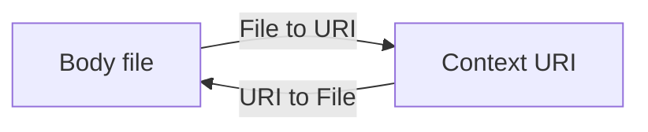

# Point the defines-context link from the file

{{ adr_metadata(date, status) }}

## :material-text-box-outline: Context

This record selects the direction of the one property that links a context URI to its local body file. The statement sits in the body file, or in a different file that names the body. The same-file statement identifies the body without naming that file. The intended reading treats that statement as the file that contains it. A JSON-LD processor treats a node with no `@id` as a blank node ([node objects](https://www.w3.org/TR/json-ld11/#node-objects)) and the `@id`-typed value `this` as a relative IRI ([value expansion](https://www.w3.org/TR/json-ld11-api/#value-expansion)). This record does not start from the current [`sparqld:context-file`](/reference/contexts/) registration.

The examples name `https://sparqld.iolanta.tech/contexts/v1.jsonld`. The context shown here is an example context that fits every example in this record. The context sparqld embeds may differ from it.

{{ source('docs/project/decisions/register-a-same-file-context-body-as/context-v1.yamlld', title='Example context') }}

## :material-arrow-decision-outline: Decision

=== ":white_check_mark: File → URI"

    The property is `defines-context`.

    

    

{{ source('docs/project/decisions/register-a-same-file-context-body-as/file-to-uri/body.yamlld', indent=4, title='Body file') }}

    

    

{{ source('docs/project/decisions/register-a-same-file-context-body-as/file-to-uri/other.yamlld', indent=4, title='Registration file') }}

{{ source('docs/project/decisions/register-a-same-file-context-body-as/file-to-uri/person.yamlld', indent=4, title='Body file') }}

    

    

=== ":question: URI → File"

    The property is `context-body`. The body file uses the token `this` for itself.

    

    

{{ source('docs/project/decisions/register-a-same-file-context-body-as/uri-to-file/body.yamlld', indent=4, title='Body file') }}

    

    

{{ source('docs/project/decisions/register-a-same-file-context-body-as/uri-to-file/other.yamlld', indent=4, title='Registration file') }}

{{ source('docs/project/decisions/register-a-same-file-context-body-as/uri-to-file/person.yamlld', indent=4, title='Body file') }}

    

    

    

    

    #### Contra

    - The body file and the registration file name the body differently.
    

    

