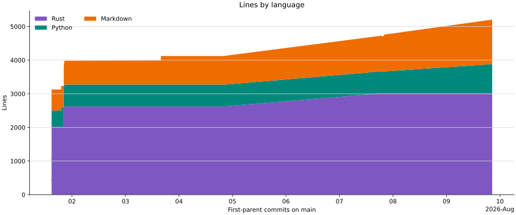

---
"@context":
  schema: https://schema.org/
  name: schema:name
  title: schema:headline
  description: schema:description
"@id": project/index.md
"@type": schema:TechArticle
icon: material/source-repository
hide: [toc]
name: sparqld project
title: Project
description: Source, build requirements, licensing, and development information for sparqld.
---

# :material-source-repository: Project

-   :material-sign-direction:{ .lg .middle } **Architecture decisions**

    ---

    Review the decisions that shape the project.

    [:octicons-arrow-right-24: Decisions](decisions/index.md)

-   :material-source-pull:{ .lg .middle } **Contributing**

    ---

    Develop and test changes from a local checkout.

    [:octicons-arrow-right-24: Contributing](contributing.md)

-   :material-tag-outline:{ .lg .middle } **Build requirements**

    ---

    Rust 1.89 or later with Cargo

-   :material-source-repository:{ .lg .middle } **Source and issues**

    ---

    [:fontawesome-brands-github: Repository](https://github.com/iolanta-tech/sparqld) ·
    [:octicons-issue-opened-24: Issues](https://github.com/iolanta-tech/sparqld/issues)

-   :material-scale-balance:{ .lg .middle } **License**

    ---

    [:fontawesome-brands-github: `LICENSE-APACHE`](https://github.com/iolanta-tech/sparqld/blob/main/LICENSE-APACHE)
    OR [:fontawesome-brands-github: `LICENSE-MIT`](https://github.com/iolanta-tech/sparqld/blob/main/LICENSE-MIT)

-   :material-map-marker-path:{ .lg .middle } **Roadmap**

    ---

    [Planned work](roadmap.md) and current limitations.

## Lines by language

Rust and Python code lines, plus Markdown content lines, at each first-parent
commit on `main`.

