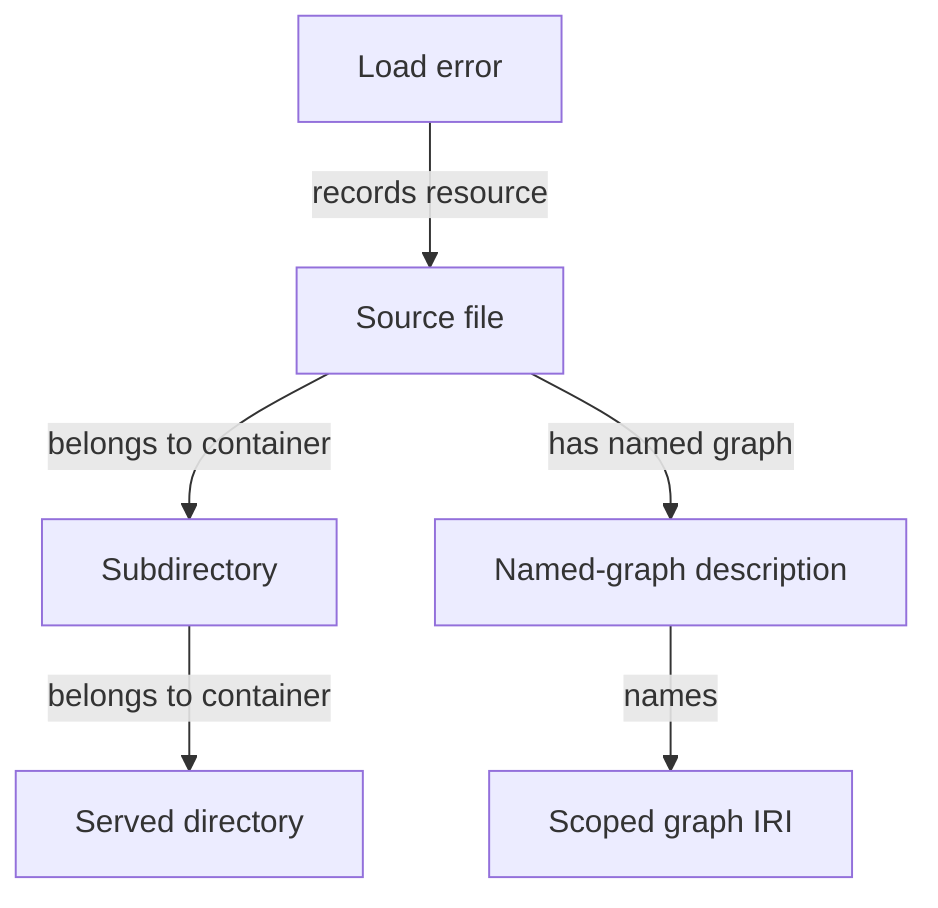

---
"@context":
  schema: https://schema.org/
  name: schema:name
  title: schema:headline
  description: schema:description
"@id": reference/file-catalog.md
"@type": schema:TechArticle
name: File catalog
title: File catalog
description: The metadata sparqld maintains about the served directory and its graphs.
---

# :material-folder-multiple: File catalog

The reserved `sparqld:` graph describes the served directory. It lets queries
relate data to the files and directories from which it came.

| Resource | RDF types | Properties |
| --- | --- | --- |
| Served directory | [`nfo:FileDataObject`](https://www.semanticdesktop.org/ontologies/2007/03/22/nfo/#FileDataObject), [`nfo:Folder`](https://www.semanticdesktop.org/ontologies/2007/03/22/nfo/#Folder) | [`nfo:fileName`](https://www.semanticdesktop.org/ontologies/2007/03/22/nfo/#fileName) |
| Nested directory | [`nfo:FileDataObject`](https://www.semanticdesktop.org/ontologies/2007/03/22/nfo/#FileDataObject), [`nfo:Folder`](https://www.semanticdesktop.org/ontologies/2007/03/22/nfo/#Folder) | [`nfo:fileName`](https://www.semanticdesktop.org/ontologies/2007/03/22/nfo/#fileName), [`nfo:belongsToContainer`](https://www.semanticdesktop.org/ontologies/2007/03/22/nfo/#belongsToContainer) |
| Source file with embedded graphs | [`nfo:FileDataObject`](https://www.semanticdesktop.org/ontologies/2007/03/22/nfo/#FileDataObject), [`sd:Dataset`](http://www.w3.org/ns/sparql-service-description#Dataset) | [`nfo:fileName`](https://www.semanticdesktop.org/ontologies/2007/03/22/nfo/#fileName), [`nfo:belongsToContainer`](https://www.semanticdesktop.org/ontologies/2007/03/22/nfo/#belongsToContainer), [`sd:namedGraph`](http://www.w3.org/ns/sparql-service-description#namedGraph) |
| Named-graph description | [`sd:NamedGraph`](http://www.w3.org/ns/sparql-service-description#NamedGraph) | [`sd:name`](http://www.w3.org/ns/sparql-service-description#name) |
| Load error | [`rlog:Entry`](http://persistence.uni-leipzig.org/nlp2rdf/ontologies/rlog#Entry) | [`rlog:resource`](http://persistence.uni-leipzig.org/nlp2rdf/ontologies/rlog#resource), [`rlog:level`](http://persistence.uni-leipzig.org/nlp2rdf/ontologies/rlog#level), [`rlog:message`](http://persistence.uni-leipzig.org/nlp2rdf/ontologies/rlog#message) |

The source resource IRI is also its named graph IRI. The catalog is updated
when source files are created, moved, or deleted.

## :material-link-variant: Context dependencies

Each source file links to the context URIs requested while parsing it through
[`jsonld:context`](http://www.w3.org/ns/json-ld#context). This includes local,
remote, and bundled contexts, including imports and nested context requests.
Repeated requests produce one edge. Inline context objects produce no URI edge.

These edges record observed requests, including unsuccessful ones. Each edge
starts at the source being parsed; it does not identify which nested context
made the request. Parsing can stop before all dependencies are discovered.

After each loading attempt, the catalog replaces that source's dependencies
with the requests observed during the attempt. Successful loads retain their
dependencies after errors are cleared. Deleting a source removes its outgoing
edges. Changes to local context files reload their dependent sources, including
sources whose previous loading attempt failed.

This source uses the bundled dollar-convenience context:

{{ example_data('context-dependencies.yamlld') }}

Unresolved requests also produce dependency edges:

{{ example_data('missing-context.yamlld') }}

Query the catalog to find the context requests:

{{ source('docs/queries/context-dependencies.rq') }}

{{ stored_sparql('docs/queries/context-dependencies.rq') | sparql_table }}

The [recursive context example](context-dependencies.md) demonstrates failed
imports, dependency queries, and recovery after a context edit.

## :material-graph-outline: Embedded graphs

For every embedded graph, the catalog uses
[`sd:namedGraph`](https://www.w3.org/TR/sparql12-service-description/#sd-namedGraph)
to link the source dataset to an [`sd:NamedGraph`](http://www.w3.org/ns/sparql-service-description#NamedGraph) description. Its [`sd:name`](http://www.w3.org/ns/sparql-service-description#name) is
the scoped graph IRI. This is the SPARQL Service Description vocabulary's
specific model for named graphs in a dataset.

## :material-database-search-outline: Query the catalog

This query lists every source file and its declared embedded graphs. A source
without embedded graphs has an empty `?graph` value.

{{ source('docs/queries/file-catalog.rq') }}
